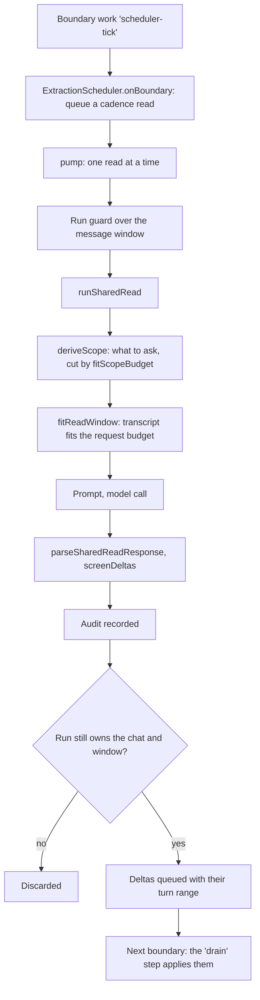

# Reading the story off the critical path

The story learns what happened by asking a model to read the recent chat. That read never blocks your turn: it runs in
the background, and whatever it finds waits until the next boundary to land.

- **Scheduling.** On boundaries where no transition fired, the scheduler queues a cadence read up to the newest stable
  message. A rollback queues a reread at a higher priority. Reads run one at a time and retry with backoff.
- **Ownership.** Each read carries a run guard: chat, story, story content and the message window. If you edit or swipe
  inside the window while the read is out, its answer is thrown away.
- **Scope and budget.** The read asks only about what the current checkpoint can use: qualities, quests, relationships,
  undiscovered entries. `fitScopeBudget` keeps those question units within a token allowance, and `fitReadWindow` trims
  the transcript to what the model's context allows.
- **Parse and screen.** The answer is parsed against the read contract and screened. Accepted and rejected deltas, the
  prompt and the window go into an audit kept with the chat (the last 20).
- **Landing.** Accepted deltas are queued with the turn range they came from. They become visible only at the next
  boundary's drain step, where a newer covering read supersedes an older one and values the author set by hand win.

## Sources

- `src/extraction/scheduler.ts`: `ExtractionScheduler`, `ExtractionScheduler.onBoundary`, `ExtractionScheduler.schedule`, `SchedulerHost`
- `src/extraction/sharedRead.ts`: `runSharedRead`, `fitReadWindow`, `screenDeltas`, `readContract`
- `src/extraction/scopeBudget.ts`: `fitScopeBudget`, `scopeSlots`, `SCOPE_EXTRA_TOKENS`
- `src/extraction/scopeSources.ts`: `readScopeSources`, `SCOPE_SOURCES`
- `src/extraction/scope.ts`: `deriveScope`
- `src/extraction/parse.ts`: `parseSharedReadResponse`
- `src/extraction/contract.ts`: `renderSharedReadPrompt`, `hashContract`
- `src/runtime/coordinators/extractionCoordinator.ts`: `ExtractionCoordinator`, `ExtractionCoordinator.applyAudit`
- `src/runtime/runToken.ts`: `beginRun`, `tokenMatches`, `RunGuard`
- `src/engine/applyQueue.ts`: `ApplyQueue.drainAtBoundary`
