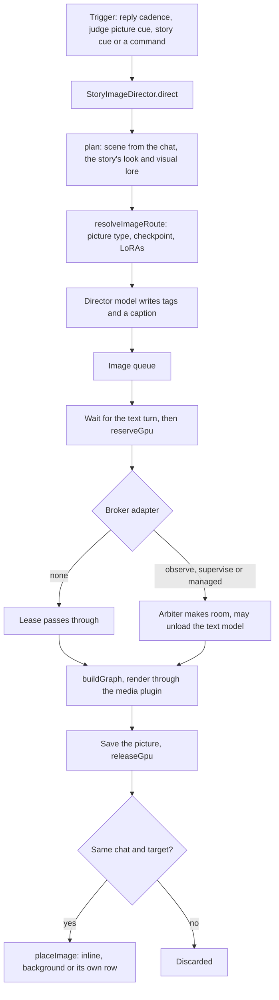

# Images and the GPU

Story pictures are rendered by ComfyUI on the same GPU that may also run the text model. A broker shares the card: an
image waits for the text turn, takes a lease, renders, and only lands if the chat has not moved on.

- **Triggers.** A picture can follow every few player turns, a judge's "this deserves a picture" read, an authored
  illustration cue on a checkpoint or scene (drawn once per beat), or a manual command.
- **Planning.** The director builds the scene from recent messages, the story's look and cast and the visual details
  in its lorebooks. `resolveImageRoute` picks the checkpoint, LoRAs, aspect and placement, checked against what ComfyUI
  reports as installed. A director model writes the tags and caption.
- **The lease.** A render waits until no reply or voice chain is running, then asks the GPU plugin for a lease with the
  models and size it needs. Without the plugin, images still run, unbrokered.
- **Adapters.** `none` passes images through. `observe` unloads and reloads a text server you started. `supervise`
  runs an arbiter that starts the text server on demand, with admission over GPU and RAM headroom. `managed` hands the
  same lease routes to the local controller.
- **Reclaiming ComfyUI.** When loading text would leave too little GPU memory, the arbiter first asks an idle ComfyUI to
  free its models, and stops it only if it has no queued job and has not rendered recently.
- **Placement.** A picture is dropped if the story, chat or target message changed meanwhile. Standalone pictures are
  posted as the extension's own rows, which a group Regenerate removes before regenerating.

## Sources

- `src/image/runtime.ts`: `StoryImageDirector`, `StoryImageDirector.direct`, `StoryImageDirector.plan`, `StoryImageDirector.onReply`
- `src/image/routing.ts`: `resolveImageRoute`, `pickImageCheckpoint`
- `src/image/graph.ts`: `buildGraph`
- `src/image/imageRowsHost.ts`: `placeImage`, `imageRows`
- `src/services/stHost/image.ts`: `imagePlace`, `imageSave`
- `src/services/stHost/gpuBroker.ts`: `reserveGpu`, `releaseGpu`, `gpuBrokerStatus`, `BROKER_ADAPTERS`
- `server-plugin/story-orchestrator-gpu/index.mjs`: `start`, `init`
- `server-plugin/story-orchestrator-gpu/broker/comfyReclaim.mjs`: `freeIdleComfy`, `stopIdleComfy`
