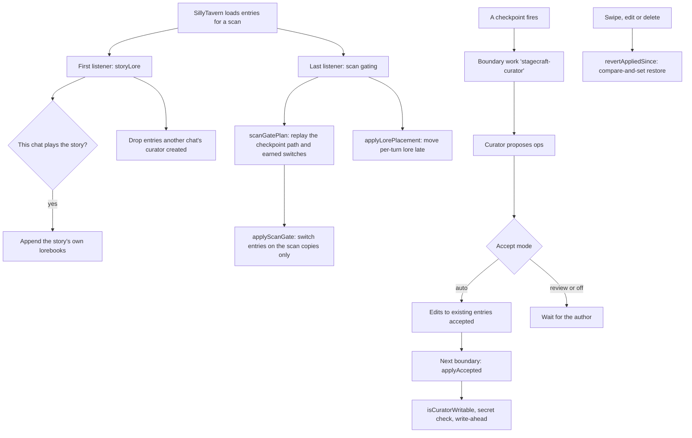

# Lore

A story's lorebooks reach only the chats that play it. Which entries are live follows the path you took through the
story, and a background curator may propose lore edits, applied only at a boundary and only inside the books the author
allowed.

- **Story books per chat.** The first listener on SillyTavern's entry-loading event appends the playing story's
  lorebooks, but only when the open chat is the one the story was loaded into. Nothing selects a story book globally.
- **Checkpoint gating.** Entries any checkpoint switches belong to the story's gated set. The plan starts them off and
  replays the checkpoint path, plus switches earned from quests and other progress. In scan mode only SillyTavern's
  per-scan copies change; the files stay as the author wrote them.
- **Late placement.** Non-constant entries of the story's own books move to a fixed depth on the scan copies, so the
  start of the prompt stays the same between turns and the model server can reuse its cache. A story can opt out.
- **The curator proposes.** On a fired transition the curator reads the scene and proposes typed ops. In auto mode,
  edits to entries it was shown are accepted; new entries always wait for the author.
- **Apply at a boundary.** Accepted ops apply after effects at the next boundary. Each one is refused if it would
  restate a held secret, re-checked against the story's allowed books at the write itself, never touches a gated
  entry, and saves a write-ahead record first.
- **Rollback.** Every rollback reverts curator writes made since the message, newest first, and only where the entry
  still holds what the curator wrote.

## Sources

- `src/runtime/storyLore.ts`: `createStoryLore`, `appendStoryLore`, `storyLoreBooks`, `withoutForeignCreated`, `storyLoreFor`
- `src/services/stHost/worldInfoScan.ts`: `installStoryLoreScan`, `installScanGating`
- `src/runtime/scanGatePlan.ts`: `scanGatePlan`, `applyScanGate`, `restsOffIn`
- `src/runtime/worldInfoGates.ts`: `worldInfoPlan`, `releasePlan`, `earnedSwitches`
- `src/runtime/lorePlacement.ts`: `lorePlacementFor`, `applyLorePlacement`, `WI_POSITION_AT_DEPTH`
- `src/stagecraft/scope.ts`: `isCuratorWritable`, `curatorLorebooks`, `isCheckpointGated`
- `src/stagecraft/curatorTiers.ts`: `routeByMode`
- `src/runtime/coordinators/stagecraftCoordinator.ts`: `StagecraftCoordinator`, `StagecraftCoordinator.runCuratorPass`, `StagecraftCoordinator.applyAccepted`, `StagecraftCoordinator.revertAppliedSince`
- `src/runtime/curatorWriter.ts`: `CuratorWriter`, `CuratorWriter.writeOp`, `CuratorWriter.revertAppliedSince`
