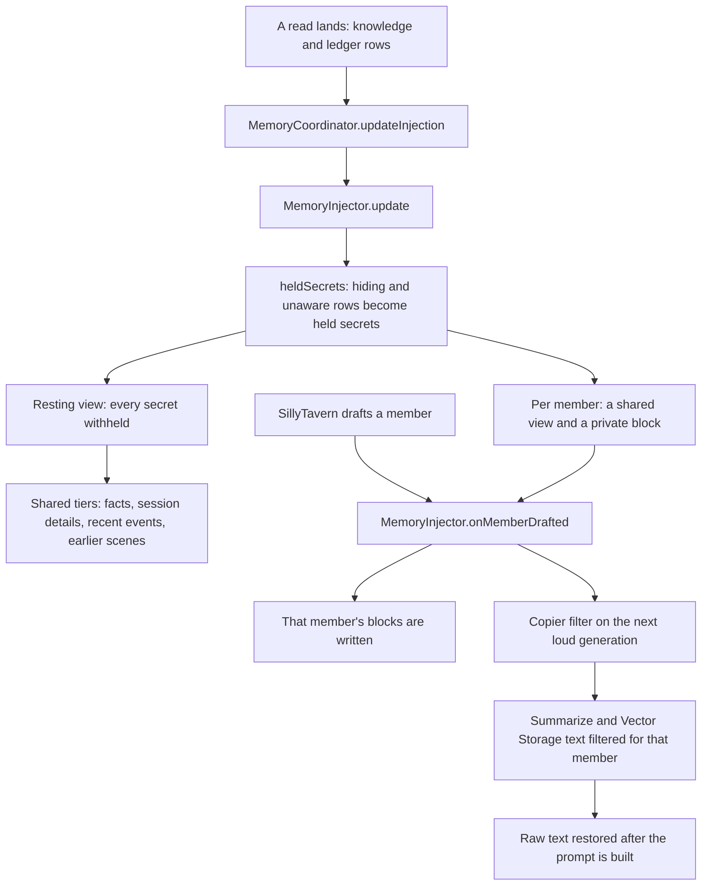

# Memory and held secrets

Memory reaches the model in labelled tiers. When a character hides something, or someone is unaware of it, that secret
is held back from everyone who should not know it, on every path into a prompt.

- **Tiers.** Memory is written into four labelled prompt slots: established facts, session details, recent events and
  earlier scenes. A ledger and a per-member private block sit beside them.
- **Held secrets.** `heldSecrets` turns every live hiding or unaware row into a held secret with its phrasings, the
  people who know it, and, for unaware rows, the people it is kept from. `keptFrom` asks whether a text restates a secret
  a given member may not see; `withoutSecrets` and `withoutSecretLines` drop the sentences or lines that would leak.
- **Resting view and drafted member.** The resting tiers are built with no member, so every secret is withheld. For each
  enabled member the injector stages a filtered shared view and a private block, and writes them when SillyTavern drafts
  that member. Quiet and impersonate generations never carry a member's private knowledge.
- **Refresh.** A write that changes injected memory refreshes the injection itself, so a member drafted right after a
  read gets the new state.
- **Copier filtering.** SillyTavern's Summarize and Vector Storage copy the transcript into the prompt. On each loud
  generation their text is rewritten through the same rule for the drafted member and restored afterwards. With no
  draft, no secret, or the filter switched off, the raw text passes.

## Sources

- `src/memory/heldSecrets.ts`: `heldSecrets`, `HeldSecret`, `keptFrom`, `withoutSecrets`, `withoutSecretLines`, `sharedTierView`, `ledgerWithoutSecrets`
- `src/runtime/memoryInjector.ts`: `MemoryInjector`, `MemoryInjector.update`, `MemoryInjector.onMemberDrafted`, `MemoryInjector.restingEntries`, `MemoryInjector.restingFilter`, `MemoryInjector.copierView`
- `src/memory/inject.ts`: `MEMORY_BLOCK_LABELS`, `writeMemoryBlocks`, `applyMemoryInjection`, `applyEpistemicInjection`
- `src/runtime/coordinators/memoryCoordinator.ts`: `MemoryCoordinator`, `MemoryCoordinator.updateInjection`, `MemoryCoordinator.applyEpistemic`, `MemoryCoordinator.applyLedger`
- `src/runtime/copierFilterHost.ts`: `startCopierFilter`, `CopierFilter`
- `src/services/stHost/copierPrompts.ts`: `viewHostCopierPrompts`, `wrapVectorsInterceptor`, `unwrapVectorsInterceptor`, `FILTERED_COPIER_KEYS`
