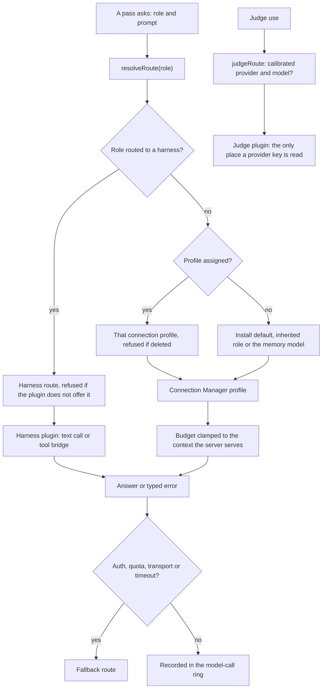

# Models and routes

The extension uses models for many jobs besides the reply: reading the story, memory, the curator, the wizard, Ask, the
judge. Each job is a **role**, and each role resolves to one route.

- **Route order.** A role harness wins, then an assigned profile, then the install default (authoring roles), then the
  role it inherits from, then the memory model. A route that is set but not answering is refused and shows up as a
  setup check, never silently replaced.
- **The call.** A harness route falls back on auth, quota, transport or timeout errors; a profile route fails over on
  transport or timeout. Every call is recorded with its chat and message and is dropped on rollback.
- **Budgets.** Each role is budgeted against its own route. A profile's context comes from its preset and, for a
  llama.cpp server, is clamped to what the server reports serving. The setup checks flag a profile asking for more
  context than its server serves.
- **Harness plugin.** It runs a command-line model client on the same machine. The wizard's tool bridge exposes exactly
  the page's tool schemas and nothing else; no login file is read or copied.
- **Judge.** The judge is a read-only classifier behind its own server plugin, which holds the provider key. A use routed
  to a provider without a passed calibration for that model is refused, and an answer from a different served model is
  discarded. The judge never blocks and never writes.

## Sources

- `src/runtime/passProfiles.ts`: `resolveRoute`, `roleDefaultFrom`, `AUTHORING_DEFAULT_HARNESS`, `roleHarness`
- `src/runtime/modelCallCore.ts`: `createModelCallVia`, `failoverRoute`, `debugResponseFor`
- `src/runtime/requestBudget.ts`: `requestBudgetFor`, `routedProfileId`, `confirmPreflight`
- `src/services/stHost/contextLimit.ts`: `readProfileContextLimit`, `clampToServed`
- `src/extraction/inputBudget.ts`: `inputBudget`
- `src/runtime/checksSetup.ts`: `MODEL_CHECKS`
- `src/judge/readiness.ts`: `judgeRoute`, `providerCleared`, `calibrationProblem`
- `src/runtime/judge.ts`: `JudgeRuntime`, `JudgeRuntime.ask`
- `server-plugin/story-orchestrator-harness/index.mjs`: `createHarnessService`, `HARNESS_IDS`
- `server-plugin/story-orchestrator-harness/agentBridge.mjs`: `createAgentBridge`, `BRIDGE_HARNESSES`
- `server-plugin/story-orchestrator-judge/index.mjs`: `resolveKey`, `sizeIssues`, `createAdaptiveRate`, `PROVIDERS`
