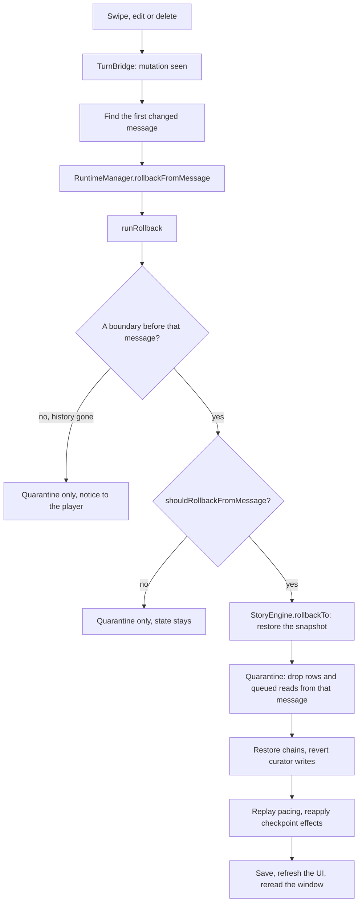

# Rollback

Swiping, editing or deleting a message rewrites history. The story follows: whatever that message caused is undone, and
the story continues as if the new version had always been there. Rolling back and replaying give the same state.

- **Detection.** `TurnBridge` listens for swipes, edits, deletes and updates. An edit that leaves the saved text
  unchanged is ignored. A delete is decoded against the chat it remembers to find the first removed row; an edit starts
  from the earliest message that drifted.
- **Is a rollback needed?** The engine scans the boundary log from that message on. It rolls back when a transition
  fired there, when one of the `ROLLBACK_DETECTORS` saw its keys move (quests, story time, factions, relationship labels
  and the rest), or when an applied read covered the message. Every compiled code key has a detector or a written reason
  to be exempt.
- **Quarantine always runs.** Even when the engine has nothing to restore, memory rows, model calls, audits and other
  per-message records from that message on are dropped. Promises, witness records and rumors roll back by message id,
  and `discardPendingFrom` drops queued writes whose read window reached the message.
- **Applied rollback.** `rollbackTo` restores the newest snapshot at or before the target boundary. The runtime then
  repairs the active checkpoint, reverts lore curator writes made since (only where the entry still holds what the
  curator wrote), replays pacing and reapplies the checkpoint's effects.
- **History gone.** If no retained boundary comes before the message, the story keeps its state and the player sees a
  notice instead of a silent mismatch.

## Sources

- `src/runtime/turnBridge.ts`: `TurnBridge`, `MutationKind`, `isStoredSwipeReply`
- `src/runtime/runtimeManager.ts`: `RuntimeManager.rollbackFromMessage`, `RuntimeManager.rollbackOnEnter`
- `src/runtime/rollback.ts`: `runRollback`, `repairActiveCheckpoint`, `RollbackDeps`, `LOST_CHECKPOINT`
- `src/engine/rollbackDetectors.ts`: `ROLLBACK_DETECTORS`, `ROLLBACK_EXEMPT`, `rollbackMoved`
- `src/engine/engine.ts`: `StoryEngine.shouldRollbackFromMessage`, `StoryEngine.rollbackTo`, `StoryEngine.discardPendingFrom`, `StoryEngine.boundaryBeforeMessage`
- `src/engine/applyQueue.ts`: `ApplyQueue`, `ApplyQueue.discardReadingFrom`
- `src/memory/promises/state.ts`: `rollbackPromises`
- `src/memory/witness/state.ts`: `rollbackWitness`
- `src/memory/rumors/state.ts`: `rollbackRumors`
- `src/runtime/recapPort.ts`: `rollbackRecap`
