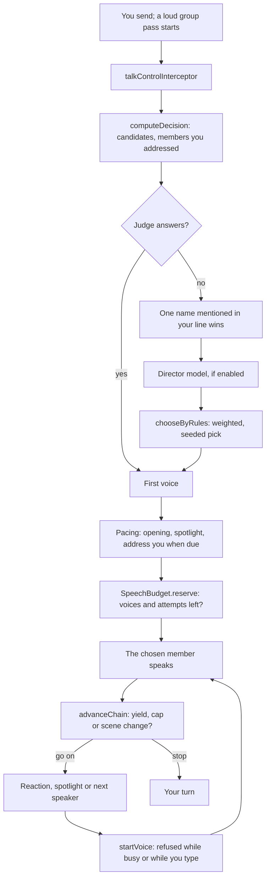

# Talk pacing

In a group, the story decides who speaks, how many characters answer one message, and when to hand the turn back to you.
Picks are seeded, so a swipe or a replay picks the same way.

- **Profiles.** Each checkpoint's talk settings resolve to a policy built on one of five profiles: opening,
  conversation, decision, action and aftermath. A profile sets the voice budget, lead preference, target length, a cap
  on consecutive turns, the spotlight threshold, when to address you, and whether reactions happen. Authored keys
  override it.
- **First decision.** Candidates are the present members plus anyone your line addressed. The judge decides first if it
  is on; otherwise a single name mentioned in your line wins, then the director model, then a weighted rule pick. The
  decision is cached per chat, checkpoint, message and revision, so editing your line decides again.
- **Pacing.** Spotlight hands the next voice to whoever has been quiet longest past the threshold. A reaction adds one
  short line after something consequential, then yields. Address turns a voice toward you when nobody has asked you
  anything for a while.
- **Budget.** `SpeechBudget` refuses a voice once this message has used up its voices or attempts; the chain ends there.
- **Yield.** After each voice the chain ends when you were asked a question, the cap was reached, the checkpoint
  changed, a reply came back empty, or you sent a message. The next voice starts through `startVoice`, which refuses
  while SillyTavern is generating or while your input box holds text.
- **Seeded chance.** Picks and tie-breaks draw from a stream seeded by chat, story and boundary.

## Sources

- `src/talk/policy.ts`: `resolveTalkPolicy`, `TALK_PROFILE_SHAPES`, `TalkPolicy`, `SPOTLIGHT_QUIET_DEFAULT`
- `src/talk/rules.ts`: `buildCandidates`, `addressedMembers`, `narrowByMention`, `chooseByRules`
- `src/runtime/talkControl.ts`: `TalkController`, `TalkController.intercept`, `TalkController.onPlayerMessage`, `TalkController.onWrapperFinished`, `TalkController.onGenerationStarted`
- `src/runtime/talkPacing.ts`: `TalkPacing`, `TalkPacing.spotlight`, `TalkPacing.reaction`, `TalkPacing.address`, `TalkPacing.reserve`
- `src/runtime/speechBudget.ts`: `SpeechBudget`, `SpeechBudget.reserve`
- `src/services/stHost/voiceStart.ts`: `startVoice`, `VOICE_BUSY`, `VOICE_DRAFT`
- `src/runtime/chance.ts`: `talkDrawStream`, `createChanceSeams`, `TALK_DRAW_KEY`
- `src/runtime/talkPort.ts`: `loadTalkKit`, `talkKit`
