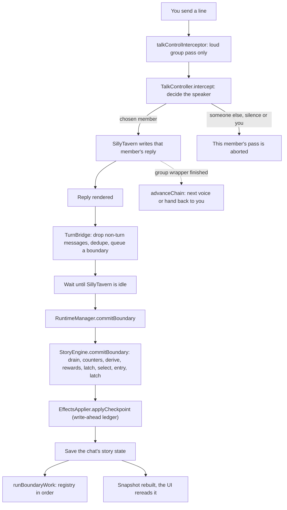

# A turn, end to end

A turn starts when you send a message and ends when the story has decided whether to move on. Replies stream as usual;
the story only ever acts at a **boundary**, the moment a reply has finished rendering.

- **Speaker direction.** At startup the runtime installs `talkControlInterceptor`. It only acts in a group chat and on
  a loud pass. `TalkController.intercept` opens one chain per turn and decides who speaks, cached by chat, checkpoint,
  last message and its revision. A member who was not chosen has its pass aborted. See [Talk pacing](talk.md).
- **TurnBridge.** It listens to SillyTavern's render events. Greetings, extension messages and thought-only replies are
  not turns. Each accepted reply becomes one pending boundary with its own run guard, and the queue drains one at a time
  once SillyTavern is no longer generating.
- **Boundary commit.** `RuntimeManager.commitBoundary` first checks the last chat save landed and this run still owns
  the chat. Then the engine runs one fixed order (`BOUNDARY_STEPS`): drain the queued reads, refresh the counters,
  derive computed values, close quests and pay rewards, a latch pass, select at most one transition, and only on a fired
  transition the new checkpoint's entry followed by a second latch pass.
- **Effects.** The new checkpoint's effects (Author's Note, lore, cast, background and so on) go through
  `EffectsApplier`. Each host write first saves a pending ledger row and is refused if that row did not save.
- **Boundary work.** Only after the save does the boundary work registry run, sorted by `order`: the game layer and
  recap first, then the extraction scheduler, the curator and the rest. Each entry has its own `when` and its own error
  handling.
- **Snapshot.** The runtime invalidates its one snapshot and notifies subscribers; every panel, the HUD and the inline
  timeline rerender from it.

## Sources

- `src/runtime/wiring/talk.ts`: `startTalk`
- `src/runtime/talkControl.ts`: `TalkController`, `TalkController.intercept`, `TalkController.onWrapperFinished`
- `src/services/stHost/voiceStart.ts`: `startVoice`, `VOICE_BUSY`
- `src/runtime/turnBridge.ts`: `TurnBridge`, `NON_TURN_MESSAGE_TYPES`, `isTurnMessageType`, `hostMessageId`
- `src/runtime/runtimeManager.ts`: `RuntimeManager`, `RuntimeManager.commitBoundary`, `RuntimeManager.notify`, `RuntimeManager.getSnapshot`
- `src/engine/engine.ts`: `BOUNDARY_STEPS`, `StoryEngine`, `StoryEngine.commitBoundary`
- `src/runtime/boundaryWork.ts`: `BOUNDARY_WORK`, `runBoundaryWork`, `BoundaryWorkItem`
- `src/runtime/effectsApplier.ts`: `EffectsApplier`, `EffectsApplier.applyCheckpoint`, `PENDING_NOT_SAVED`
- `src/runtime/snapshotBuilder.ts`: `buildRuntimeSnapshot`, `snapshotSources`
