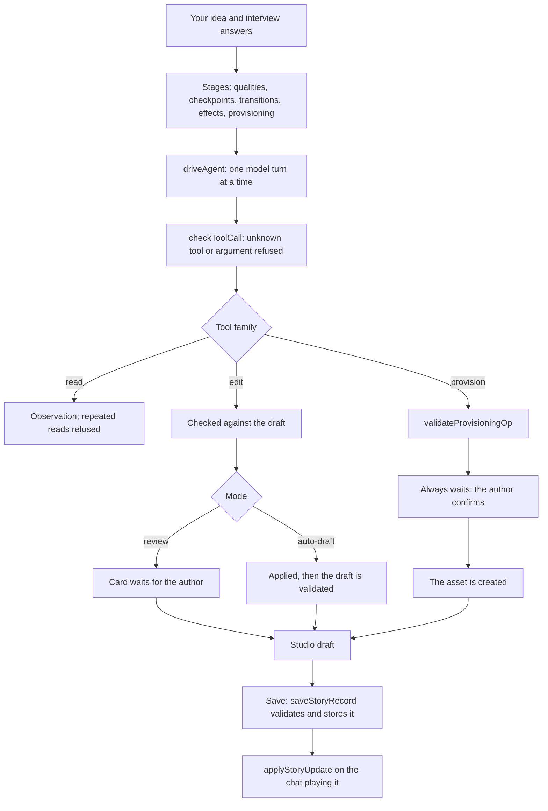

# The story wizard

The wizard turns an idea into a playable story. It writes only through checked tools, and anything that creates a real
asset (a character card, a lorebook, a group) waits for the author's click.

- **Interview and stages.** A few questions shape the run. Each stage limits which kinds of change the model may make.
- **The loop.** `driveAgent` runs one model turn at a time and checks after each that the draft is still the one it
  started on. Repeating a refused call three times stops the run, and re-reading unchanged information is refused.
- **Tool checks.** `checkToolCall` refuses unknown tools and arguments with a did-you-mean hint, then parses edits and
  provisioning calls into typed operations.
- **Edits.** In review mode each edit waits as a card; in auto-draft mode it is applied and the draft is validated, with
  the result reported back to the model.
- **Provisioning.** Cards, lorebooks, entries, groups and new personas are create-only. They are validated and never
  applied automatically: each waits for the author's confirmation.
- **Saving.** The Studio draft is changed only through typed mutations. Saving validates the story, keys it by its
  authored id and updates the library record. A chat playing that story takes the change only through its own update
  path: compatible changes swap in place, others ask to keep, restart or cancel.

## Sources

- `src/copilot/agent/tools.ts`: `checkToolCall`, `AGENT_TOOLS`, `PROVISION_TOOLS`, `EDIT_TOOLS`
- `src/copilot/agent/loop.ts`: `executeReply`, `checkDraft`, `REPEAT_LIMIT`, `newAgentSession`
- `src/copilot/agent/drive.ts`: `driveAgent`, `confirmProvisioning`
- `src/copilot/stages.ts`: `STAGE_OPS`
- `src/wizard/provisioning.ts`: `validateProvisioningOp`, `planProvisioning`
- `src/studio/draft.ts`: `useDraftStore`, `newStoryDraft`
- `src/runtime/storyLibrary.ts`: `saveStoryRecord`, `confirmLibrarySave`
- `src/runtime/storyUpdate.ts`: `applyStoryUpdate`
